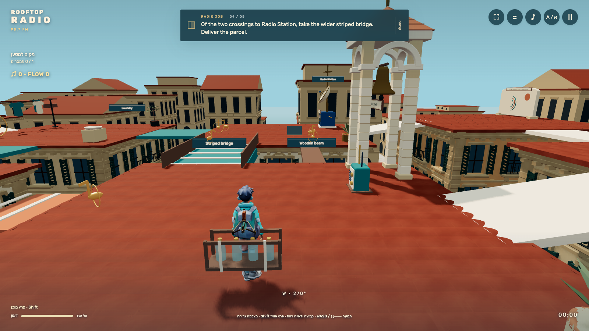

# Visual review

27 October 2026. Actual gameplay captures are distinct from conceptual built-in imagegen targets. Both original targets were generated and inspected before gameplay source; exact prompts and built-in mode remain in `docs/visual-targets`.

| Conceptual target | Current actual gameplay,1600×900 |
|---|---|
|  |  |
|  |  |

The real game retains the warm plaster/terracotta/teal palette, street depth, greenhouse landing, brass devices and chase view. The imported Tripo courier has65 real joints and actual idle/run/jump/jump_down clips; the final segment supplies a derived landing action. A separate Tripo glider folds against a spine socket, levels independently of animated torso pitch and is held by actual arm/finger-bone posing. Original Blender building modules supply recessed windows, shutters, balconies, arches and tiled roofs. Local Rubik provides Hebrew and explicit LTR English.

The original target's invented solution ribbons and gold answer beacons were excluded. Current gameplay uses optional note pickups and visible physical wind rather than a solution path. The human's later ambiguity feedback changed the comparison layout to two nearby crossings of one gap.

## 27 October: parkour-delivery redesign

The human rejected the opposite/café inference, a global wider-path comparison, pass-through scenery and the static walking loop. The new actual captures replace those with a stable mental map: blue Radio Station west, red-canopy café east, short staged English and exactly two adjacent crossings of the same gap. `07-width-spawn.png` is the exact x=3 / time=0 west-facing start. The wooden beam and broader teal/cream striped bridge are simultaneously visible and end at the same roof. The wider bottle crate makes the need for space visible. Both alternatives contain optional notes; pickups are movement rewards, not goal-only answer markers.

Nine original detailed landmarks replace the primitive models: a compact banded tank/ladder, an open stone belfry, round clock/copper cupola, open-doored glasshouse with benches/plants, scalloped café porch/kiosk/furniture, blue radio cabinet/dish, actual laundry shapes, antenna and painted mural. The former ball trees are replaced by olive/rosemary/agave forms. Shared structural collision data preserves open passages. Geometric proof/provenance is in `docs/art/landmarks.md`; the lead inspected the final models in actual play as well as offline renders.

Interaction points now match the objects people walk to. Frame 03 delivers at the radio immediately beside the greenhouse; frame 11 reaches the café service counter. The station is the blue cabinet itself, with no duplicate generic relay. The glider's full group is 0.74 of its former span, exposing substantially more landing area while retaining bone-driven hand contact. Factual labels move closer to their landmarks and the last-departed roof label stays hidden during flight.

The green→bell connection is now a jump/glide gap. Wind streaks, optional brass music notes, a once-per-flight air burst, dust/landing rings, quick recovery and flow scoring animate the repeated delivery action. Mobile captures show the wing fitting within portrait width, a visible approach and a working touch burst. Exact-spawn and flight views were independently inspected. A minor limit remains: a wing can still cover part of the Greenhouse label during a particular glide angle; the glasshouse and adjacent radio stay visible. Generic background building repetition and the rigid folding glider remain deliberate stylization. No human fun gain is claimed by the test suite.
