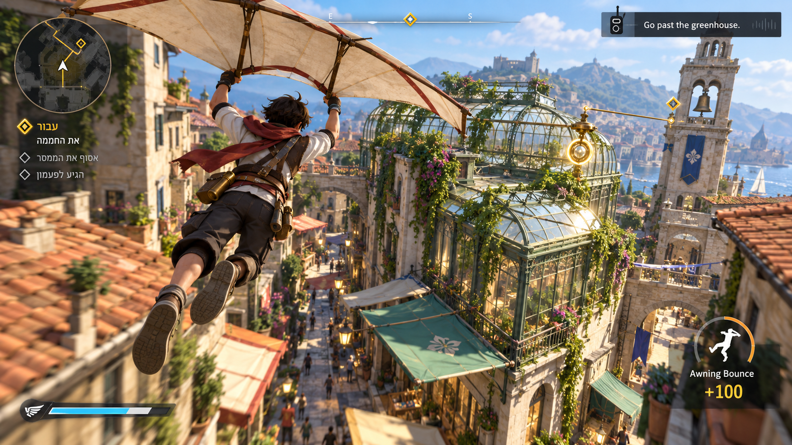
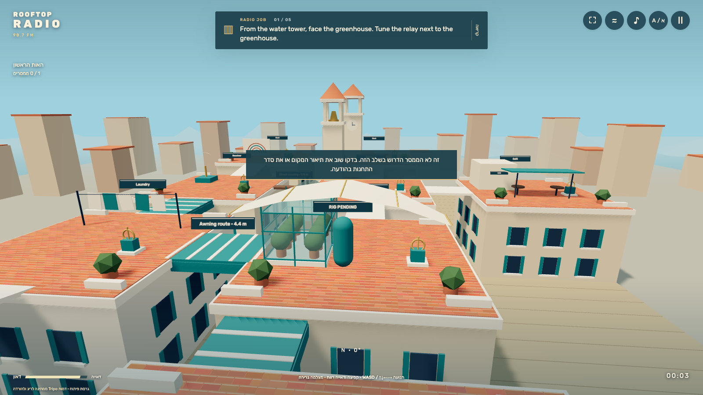
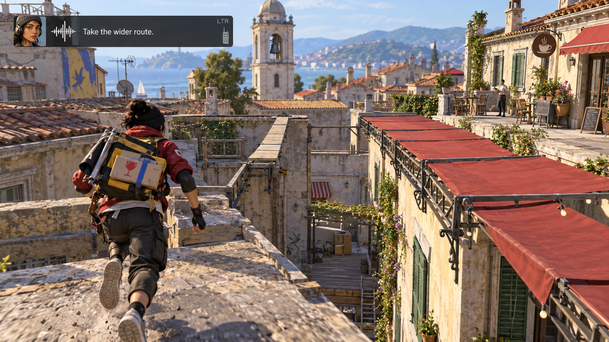
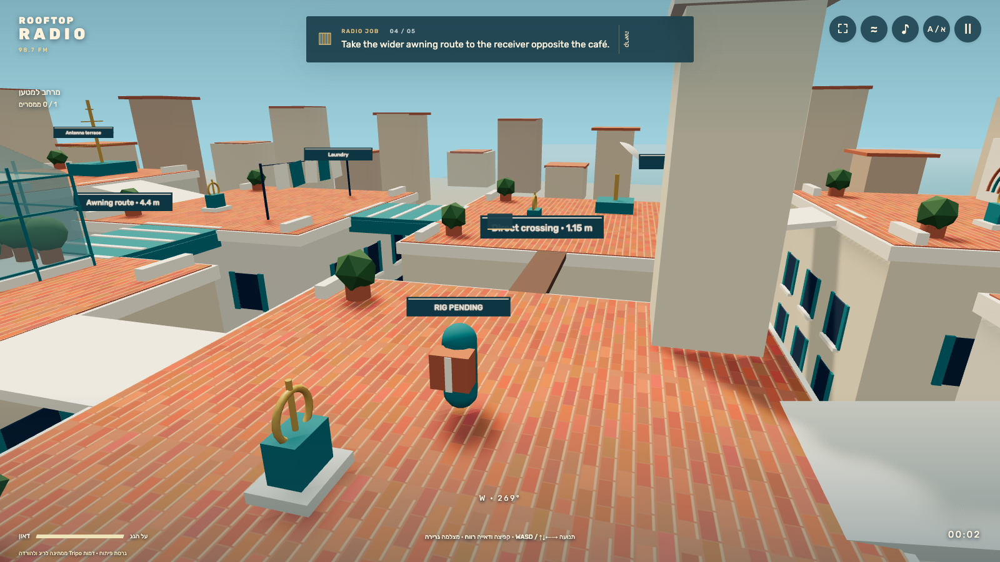

# Visual review

26 October 2026. Targets are conceptual built-in imagegen outputs; actual gameplay captures are separate.

## Target inspection before implementation

Both targets were generated, displayed, inspected and copied into `docs/visual-targets` before gameplay implementation. Exact prompts and built-in mode are recorded there.

Target 1 establishes a chase camera, cloth-wing silhouette, reachable greenhouse landing, street depth, terracotta/cream materials, teal awnings, brass relay and bell skyline. It invented a solution minimap/ribbon and gold beacons. Those cues conflict with the learning contract and are deliberately excluded.

Target 2 establishes a roof-level junction with different crossing widths, folded wing, fragile parcel, café reference and visible recovery deck. Most of the frame stays navigable space with a small LTR radio strip. The generated couriers differ; a single original Tripo courier must supply runtime identity.

## Implemented architectural direction

Three.js geometry has warm plaster façades, shaded windows/shutters, tiled roofs, trim, glass greenhouse, bell/clock towers, water tank, laundry, antenna, mural, café awning, brass relays, broad awning loop and narrow direct beam. Static meshes merge by material. Lighting uses daylight, blue atmospheric depth and real shadows. Local Rubik serves a Hebrew shell and explicit LTR English.

## Acceptance still open

No final target match is claimed. Material deviation: no acquired local Tripo courier/rig/clips yet; an explicit `RIG PENDING` capsule is visible. Architecture is more stylized and simpler than the targets. Actual prototype captures and comparisons are recorded below. Final art acceptance and a new GLB-visible pass remain blocked by Chrome access recovery.

## Side-by-side prototype comparison

| Generated conceptual target | Actual rendered prototype |
|---|---|
|  |  |
|  |  |

The real canvas has the intended cream/terracotta/teal palette, a glass greenhouse landing, brass radios, recognizable skyline, depth and sparse radio HUD. It does not match the target's detailed courier, dense building surfaces or fabric detail. Those material differences remain explicit.

The first actual review found an oversized sign behind the player, the bell tower blocking much of the junction camera, and a parcel placed on the model's front. Source fixes hide behind-player signs, move the tower into a roof corner and put the parcel on the back. The width-choice capture is now taken after a real camera turn toward the crossings. Fresh captures verify these changes; no synthetic image is used as gameplay evidence.

## Phone and completion inspection

The 390×844 actual glide shows the landing ahead with reachable touch controls, readable English and visible development marker. The vocabulary panel fits the same portrait viewport and pauses action. The actual final campaign panel renders a route trace and separates movement time from assistance. These are observed prototype frames, not generated illustrations.

The palette, camera occupancy and route geometry now broadly follow the targets, with no answer ribbon or beacon. The main remainder is still substantial: the real rigged courier and clips, glider asset if its pending Tripo job succeeded, detailed material/architecture density, and final comparison with those assets. The procedural architecture is authored environment geometry; the capsule is an openly labelled temporary collider visualization.

Final fresh frame07 confirms the parcel is visible on the back, both narrow beam and broad awning connections are in view, and the current-roof label no longer obstructs the crossing. Frame12 shows one accumulated recovery rather than the last job's zero. Target2's café and receiver are not simultaneously visible from this prototype camera; the player can orbit to inspect both, and this composition difference remains for the final art pass.
